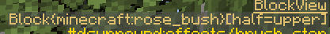

Block Specifications
====================

Block specifications are matchers utilized in various parts of the configuration. There are 3 forms of matchers: Direct, Tag, and BlockState match.

A block ID without a namespace is in the ``minecraft`` namespace (ex, ``stone`` is ``minecraft:stone``), and a tag without a namespace is in the ``dsurround`` namespace
(ex, ``#logs`` is ``#dsurround:logs``). It is recommended to always specify the namespace.

Direct
------

Explicit using the :term:`resource location <Resource Location>` ID of the block (ex, ``minecraft:cobblestone``). This will match all variations of the block.

Tag
---

This matcher matches based on the presence of a block tag (ex, ``#minecraft:logs``). The ``#`` prefix tells the config parser that it should be interpreted as a tag. The tag can be from any mod, and does not need to exist; a tag that does not exist simply matches nothing.

BlockState
----------

This is an enhanced version of Direct. Additional block state properties can be specified to filter down to a specific set of variants. For example, if the sound or effect only applies to fully
grown Nether Wart it can be expressed as ``minecraft:nether_wart[age=3]``. Multiple properties between the ``[]`` are comma separated (ex, ``minecraft:oak_stairs[facing=north,half=top]``). Spaces around names, values, and commas are ignored.
Properties that are not listed can have any value.

Further examples:

.. list-table::
    :widths: auto
    :align: center
    :header-rows: 1

    *   - Matcher
        - Comment
    *   - ``minecraft:redstone_wire[power=15]``
        - Matches a redstone wire that is fully powered regardless of connections.
    *   - ``minecraft:redstone_torch[lit=true]``
        - Matches a redstone torch that is lit; unlit ones will not match.

You can get information about a block while in game by using Minecraft's debug display (F3) or you can use the Dynamic Surroundings debug overlay (key needs to be mapped). When looking at a block it will
list information about that block, including any variant parameters. Here is an example from the Dynamic Surroundings debug overlay:

|

This shows the upper half of a rose bush.  The block is ``minecraft:rose_bush`` with the variant ``half=upper``. The lower portion would be the variant ``half=lower``. The three possible matchers for
the block state can be:

.. list-table::
    :widths: auto
    :align: center
    :header-rows: 1

    *   - Matcher
        - Comment
    *   - ``minecraft:rose_bush``
        - Matches any block state that uses the block ``minecraft:rose_bush``. In this case, it would match both variants.
    *   - ``minecraft:rose_bush[half=upper]``
        - Matches the upper half of a rose bush.
    *   - ``minecraft:rose_bush[half=lower]``
        - Matches the lower half of a rose bush.

Errors
------

A block specification is checked when the configuration is loaded. An unknown block, a property the block does not have, a value the property cannot take, or a formatting mistake
(such as a missing ``]``) is reported in the log with a message describing the problem, and the configuration entry containing it is ignored.
