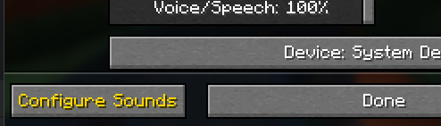
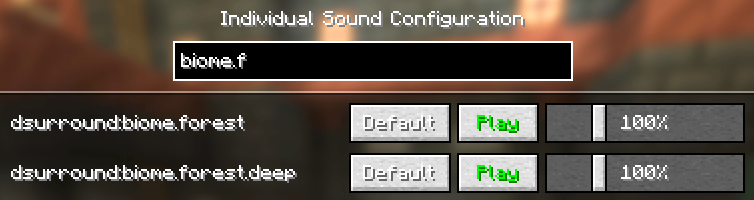

Individual Sound Configuration
==============================

The **Individual Sound Configuration** screen allows the player to customize special handling of a sound when it is played. This screen is accessible in game via keybind (if setup), or
by clicking on the *Configure Sounds* button in the bottom left corner of the *Music & Sounds* options dialog:

|

The **Individual Sound Configuration** screen will list *all* sounds that have been detected in the ``sounds.json`` file for all loaded mods and resource packs, regardless if they have been registered with Minecraft.

|

Each row lists a sound's :term:`resource location <Resource Location>` ID followed by its controls. Hovering over a row displays a tooltip with information about the sound, such as the mod or resource pack that
provides it, its sound category, its subtitle, and any credits. Hovering over one of the row's controls adds help text for that control to the tooltip.

If the resource location ID of the sound is known, it can be entered into the search box. All sounds matching the criteria will be listed.  Referencing the image above, the list was filtered to those sounds that
have ``biome.f`` in the ID. To filter by mod ID, enter in the mod ID (ex, ``dsurround``), or even if the name is not specifically known text can be entered in an attempt to locate (ex, ``zombie``).
Searches ignore case. The search text can also be a regular expression (ex, ``^minecraft:entity\.(cow|sheep)``); if it is not a valid regular expression, it is matched as plain text.

.. list-table:: Row Controls
    :widths: auto
    :align: center
    :header-rows: 1

    *   - Control
        - Description
    *   - **Default** / **Cull** / **Block**
        - Selects how the sound is handled when it is played. Clicking the button cycles through the three states. Default is **Default**. See below for details on each state.
    *   - **Play** / **Stop**
        - Plays the sound to help with identification, with its volume scaled by the volume slider. Moving the slider while the sound is playing changes its volume. Click **Stop** to end the sound early;
          the button switches back to **Play** when the sound finishes on its own. Sound category volume settings are not applied.
    *   - Volume slider
        - Scaling factor to apply to the volume when playing the sound. Value can be between 0% and 400%, with 100% being normal volume. At 0% the slider reads **OFF**, which effectively blocks the sound,
          and 400% will scale the volume 4 times.

The **Play** buttons are only shown when the game can be paused, such as in single player or from the main menu. While the screen is open with **Play** buttons shown, music is paused and other
sounds are stopped; music resumes when the screen is closed.

Click **Done** to save the changes, or **Cancel** (or press Escape) to discard them. The data for the sound configuration will be stored in the ``soundconfig.json`` file in Dynamic Surrounding's config folder.
Only sounds with settings that differ from the defaults are saved. See :doc:`modconfiguration` for more information.

Sound Handling States
---------------------

A sound can be culled or blocked, but not both. The state button shows which handling applies:

.. list-table::
    :widths: auto
    :align: center
    :header-rows: 1

    *   - State
        - Description
    *   - **Default**
        - The sound plays normally without being culled or blocked.
    *   - **Cull**
        - Plays of the sound are culled. See *Sound Culling* below. Stored in ``soundconfig.json`` as ``"action": "cull"``.
    *   - **Block**
        - The sound is blocked from playing. See *Sound Blocking* below. Stored in ``soundconfig.json`` as ``"action": "block"``.

.. note::

    Prior to 1.21.1-0.4.7 cull and block were separate toggles, and until 1.21.1-0.4.8 ``soundconfig.json`` kept them as separate ``cull`` and ``block`` flags. An older file
    is still read; a sound with both set to ``true`` is culled, as the screen showed it. The file is written with ``action`` the next time it is saved.

Sound Culling
-------------

Sound culling can be a bit challenging to wrap your mind around. Best way to understand is with an illustration. Let's say you have an animal farm, with a pen holding 50 cows. Normally, each cow could have
an ambient sound effect generated. This creates a noisy environment, and increases the load on the sound engine. To reduce the noise, the ambient sound that a cow makes can be marked for culling.

What Dynamic Surroundings will do is keep track of the when the cow ambient sound is played. If another play of that sound occurs within 1 second (the default interval), it will block those plays. Result is that
only a single cow ambient sound will be played per second. So in our example of 50 cows, instead of getting upwards of 50 sounds played, only a single instance will be permitted.

Sound Blocking
--------------

Blocking a sound will instruct Dynamic Surroundings to prevent any sound effect using that sound. This is useful for blocking sounds that are disliked, or for some reason a mod continually generates overloading
the sound engine. Only sounds that are played through the Minecraft sound engine can be blocked.

.. note::

    Dynamic Surroundings sounds can be blocked as well, so if you don't like a sound in the mod, block it.

Volume Scaling
--------------

This setting will allow the volume of a sound to be increased (value greater than 100), or decreased (value less than 100). Keep in mind this is *scaling*, it's not the actual volume at which the sound is played.

Not all sounds can be affected by volume scaling. For example, Minecraft thunder plays at a very high volume (12,000 IIRC), and applying a 1% scaling will reduce it down to 120. A sound normally plays in the volume
range of 0.0 - 1.0.
