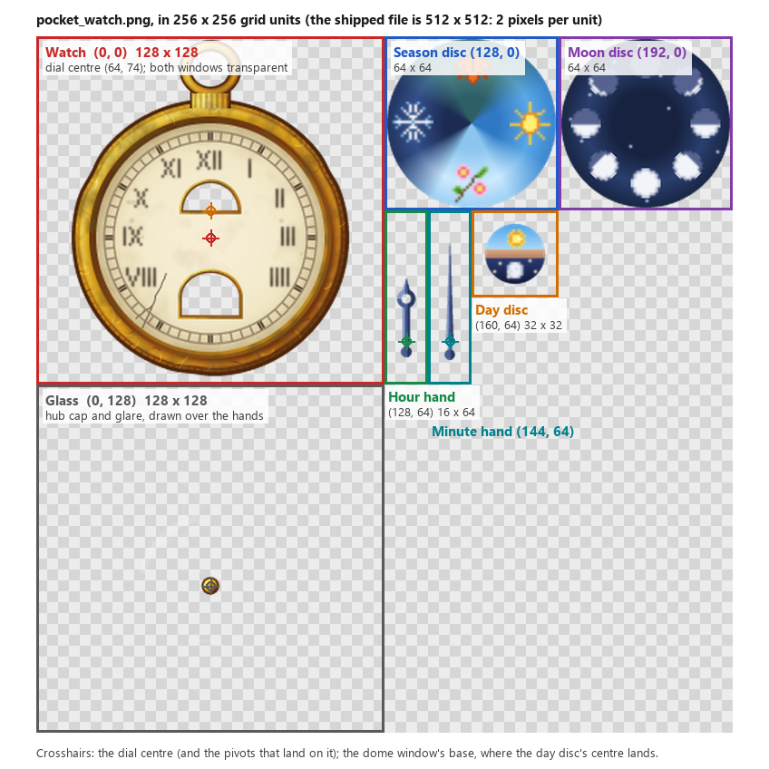

Overlay Textures
================

*Added 1.21.1-0.4.7*

The compass and the pocket watch the mod shows on screen (see :confval:`compassAndClockOptions.compassStyle` and :confval:`compassAndClockOptions.clockStyle`) are drawn from
ordinary textures, so a resource pack can replace them like any other texture: put a file of the same name at the same place in the pack, under
``assets/dsurround/textures``. They are read when resources load, so a change shows after ``F3+T`` or reselecting the pack; ``/dsreload`` is not needed.

The shipped textures are the best place to start. They can be found :asset:`here <textures>`.

The numbers of the light level overlay are not a texture in the mod: they are drawn with the game's font when they are first shown, and again when resources reload,
so a resource pack that replaces Minecraft's font changes them too.

.. list-table::
    :widths: auto
    :header-rows: 1

    *   - File
        - Used for
    *   - ``compass.png``
        - The band compass styles (``OPAQUE`` to ``TRANSPARENT_WITH_INDICATOR``)
    *   - ``compass_rose_1.png``, ``compass_rose_2.png``, ``compass_rose_3.png``
        - The ``ROSE_1`` to ``ROSE_3`` compass styles
    *   - ``pocket_watch.png``
        - The ``POCKET_WATCH`` and ``POCKET_WATCH_WITH_TEXT`` clock styles

Smooth Sampling
---------------

The roses and the pocket watch are drawn smaller or larger than their textures, depending on the GUI scale, and are sampled smoothly so they don't look blocky. That is set by
a ``.mcmeta`` file beside each texture, such as ``pocket_watch.png.mcmeta``:

.. code-block:: JSON

    {
      "texture": {
        "blur": true
      }
    }

Minecraft reads a texture's ``.mcmeta`` from the same pack as the texture, so a pack that replaces one of these textures should include the ``.mcmeta`` as well, or the texture
is drawn with hard pixel edges. That may be what a pack wants: leave the file out, or set ``"blur": false``, for a crisp pixel art look.

Compass Band
------------

``compass.png`` is 512 x 512, and holds the four band styles in eight rows of 24 pixels: two rows each, in the order ``OPAQUE``, ``TRANSPARENT``, ``OPAQUE_WITH_INDICATOR``,
``TRANSPARENT_WITH_INDICATOR``. The first of a style's rows holds the first half of a turn and the second row the second half, 256 pixels each, followed by 128 pixels that
repeat the start of the next half so the 130 pixel wide window that is shown never runs off the end of a row. The band is drawn at one GUI pixel per texture pixel, times
:confval:`compassAndClockOptions.scale`, or at half that in the screen margin (see :confval:`compassAndClockOptions.showInMargin`). Keep the marks where the
shipped texture has them.

The shipped texture comes with ``compass.png.mcmeta``, which turns on smooth sampling so the band does not flicker as it slides at small sizes. Minecraft reads
the ``.mcmeta`` file from the same pack as the texture, so a pack that replaces ``compass.png`` should include a copy of it:

.. code-block:: JSON

    {
      "texture": {
        "blur": true
      }
    }

Compass Roses
-------------

Each rose is 256 x 256, with north at the top and the rose's hub at the centre of the texture, where it turns. It is drawn 192 GUI pixels across (times
:confval:`compassAndClockOptions.scale`), and squashed to lie back as though flat in front of the player. In the screen margin (see
:confval:`compassAndClockOptions.showInMargin`) it is drawn upright instead, 64 GUI pixels across. Anything outside the rose should be transparent.

Pocket Watch
------------

``pocket_watch.png`` holds every part of the watch: the watch itself, the discs seen through its windows, the hands, and the glass. The parts are placed by the layout
below, in units of a 256 x 256 grid. Positions are read as fractions of the texture's size, so the texture can be any square size: the shipped one is 512 x 512, two pixels to a
unit, and a 1024 x 1024 one would be four. Keep it square, and keep every part where the layout puts it.

.. list-table::
    :widths: auto
    :header-rows: 1

    *   - Part
        - Position
        - Size
        - Turns about
        - Placed with that point on
    *   - Watch
        - (0, 0)
        - 128 x 128
        - |nbsp|
        - The dial centre is at (64, 74)
    *   - Season disc
        - (128, 0)
        - 64 x 64
        - Its centre
        - The dial centre
    *   - Moon disc
        - (192, 0)
        - 64 x 64
        - Its centre
        - The dial centre
    *   - Hour hand
        - (128, 64)
        - 16 x 64
        - (8, 48) in its box
        - The dial centre
    *   - Minute hand
        - (144, 64)
        - 16 x 64
        - (8, 48) in its box
        - The dial centre
    *   - Day disc
        - (160, 64)
        - 32 x 32
        - Its centre
        - (64, 64): 10 above the dial centre
    *   - Glass
        - (0, 128)
        - 128 x 128
        - |nbsp|
        - Drawn where the watch is

.. |nbsp| unicode:: 0xA0

The watch is drawn 96 GUI pixels across (times :confval:`compassAndClockOptions.scale`), above the crosshair, or 64 GUI pixels across in the screen margin (see
:confval:`compassAndClockOptions.showInMargin`). The parts are drawn in this order, each over the last:

#. The season disc, or the moon disc when no seasons mod is installed
#. The day disc
#. The watch
#. The hour hand, then the minute hand
#. The glass

The Watch
~~~~~~~~~

The case, its ring, the dial and its markings. The two windows must be transparent, as the discs are drawn behind the watch and show through them:

* **The day window** under XII is a half circle: its flat base is at y 64, and it is 10 units in radius around (64, 64), so it spans x 54 to 74 and y 54 to 64.
* **The season window** above VI is an arch about 21 units wide, centred on x 64, from y 87 at the top of the arch to y 102.5 at its base.

Windows can be made a little larger or smaller, or the frames around them changed, so long as the discs still show the right thing through them. Anything outside the watch
should be transparent.

The Season Disc
~~~~~~~~~~~~~~~

A disc with a picture for each season, 22 units from its centre: spring at the bottom, summer at the right, autumn at the top and winter at the left, each drawn upright
when it is turned to the bottom. The disc turns clockwise a quarter turn each season, bringing the season's picture to the bottom, where the season window is. Early in a
season it is turned 30 degrees short of that, so the picture is coming into the window, and late in a season 30 degrees past, so it is leaving.

The Moon Disc
~~~~~~~~~~~~~

Shown in the season window when there is no seasons mod. A disc with Minecraft's eight moon phases, 22 units from its centre: phase 0 (full moon) at the bottom, and each
following phase 45 degrees further counterclockwise, each drawn upright when it is turned to the bottom. The disc turns clockwise 45 degrees a phase, bringing the phase to the
bottom. The phases are 0 full, 1 waning gibbous, 2 last quarter, 3 waning crescent, 4 new, 5 waxing crescent, 6 first quarter, and 7 waxing gibbous.

The Day Disc
~~~~~~~~~~~~

Seen through the day window, so only its top half shows at a time. Day is on the top half with the sun at the top, and night on the bottom half with the moon at the bottom,
drawn upside down. The disc turns clockwise once a day: the sun is at the top at noon and the moon at midnight, rising on the left at 6 AM and setting on the right at 6 PM. Make
the disc a little larger than the window (the shipped one is 11 units in radius) so its edge doesn't show.

The Hands
~~~~~~~~~

Each hand is drawn pointing straight up, with the point it turns about at (8, 48) in its box; that point is placed on the dial centre. Keep the minute hand within 38 units of
the pivot and the hour hand shorter, so they stay on the dial.

The Glass
~~~~~~~~~

Drawn over the hands, the same size and in the same place as the watch: the cap over the hands' pivot, at (64, 74) in the glass as on the dial, and any glare or scratches on
the crystal. Leave the rest transparent, or the dial is hidden.

.. tip::

    Smooth sampling blends each pixel with its neighbours, so leave a transparent pixel or two around each part. Otherwise the edge of one part can show along the edge of
    the one beside it.
