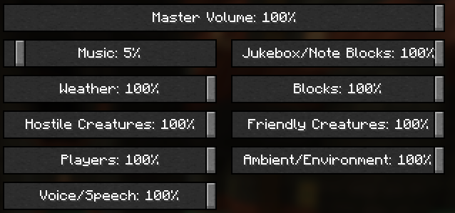

.. role:: underlined

sound_factories.json
====================

:asset:`Source reference <dsconfigs/sound_factories.json>`

:term:`Sound factories <Sound Factory>` are the heart of most sound effects generated by Dynamic Surroundings. A factory combines a :term:`sound event <Sound Event>` with information that describe the properties of that sound
when played. For example, a factory could generate a sound using the same sound event, but with varying pitch and volume.

The schema for a sound factory entry is as follows:

.. code-block:: JSON

    {
        "location": "namespace:path",
        "soundEvent": "namespace:path",
        "volume": 1.0,
        "pitch": 1.0,
        "category": "AMBIENT",
        "isRepeatable": false,
        "repeatDelay": 0,
        "global": false,
        "attenuation": "LINEAR",
        "music": null,
        "followsWind": false
    }

.. list-table:: Sound Factory Configuration
    :widths: auto
    :align: center
    :header-rows: 1

    *   - Property
        - Value Type
        - Comment
    *   - location
        - ResourceLocation
        - The :term:`resource location <Resource Location>` ID of the sound factory. It should be unique across configurations. Most configuration rules refer to a factory by this ID. An ID without a namespace is in
          the ``dsurround`` namespace. If not specified, the ID of the ``soundEvent`` is used.
    *   - soundEvent
        - ResourceLocation
        - The sound event that the factory will produce. It is a required property. This is normally the sound event ID. A full Minecraft sound event definition can also be given, in the
          same form as a data pack (ex, ``{"sound_id": "minecraft:entity.wolf.howl", "range": 32.0}``).
    *   - volume
        - FloatProvider
        - The volume scale to apply to the sound when playing. The value can either be a float, or a range with min/max (see below). Default is ``1.0``.
    *   - pitch
        - FloatProvider
        - The pitch at which to play the sound. The value can either be a float, or a range with min/max (see below). Default is ``1.0``.
    *   - category
        - String
        - The category to which the sound will belong when played. Default is ``AMBIENT``.
    *   - isRepeatable
        - Boolean
        - Whether the sound should be marked as repeatable (looped) when played. Default is ``false``.
    *   - repeatDelay
        - Integer
        - The tick delay between plays for a repeatable sound. Default is ``0``.
    *   - global
        - Boolean
        - Whether the sound is considered global or not. A global sound is heard the same regardless of where it is played, as if it were playing at the player's position, and has no
          attenuation. Setting ``global`` to ``true`` forces ``attenuation`` to ``NONE``. Default is ``false``. (*Global sounds play at the player's position starting 1.21.1-0.4.6*)
    *   - attenuation
        - String
        - Attenuation of the sound. Setting ``attenuation`` to ``NONE`` also makes the sound global. Default is ``LINEAR``.
    *   - music
        - Music
        - Properties to apply when the music manager plays the sound as music. This property is optional. See below for more details.
    *   - followsWind
        - Boolean
        - Whether the volume of a looping biome sound follows the simulated wind. The sound is quieter when it is calm (but not silent, so a windy biome still sounds windy), louder as the
          wind picks up, and louder still in thunderstorms and dust storms. It is also quieter when the player is under cover. In dimensions without wind (see :doc:`dimensions`) the sound does
          not play. Default is ``false``. (*Added 1.21.1-0.4.7*)

``category`` can be one of the following: MASTER, MUSIC, RECORDS, WEATHER, BLOCKS, HOSTILE, NEUTRAL, PLAYERS, AMBIENT, and VOICE. The name is not case sensitive, and an unknown
name is logged as a warning and treated as AMBIENT. The ``category`` property matches a sound source in the sound options
dialog, and will be scaled by the amount specified by the sound source.

``attenuation`` is either LINEAR or NONE (not case sensitive; an unknown value is logged as a warning and treated as LINEAR). Most sounds are LINEAR, meaning the volume is linearly scaled based upon the distance from the player. Most sounds in Minecraft are LINEAR. NONE are for
sounds that do not concern themselves with distance. Such sounds are things like music, button clicks, and background sound tracks.

``volume`` and ``pitch`` are special in that they can either have a single float value, or have a range. If a range is specified, when a sound instance is created a random value
is selected from the range. By varying volume and pitch in this fashion complex sounds can be layered to give an overall sound impression. For example, waterfall splash sounds
have varying pitch. If the pitch were not varied, an artificial harmonic would be introduced which is not enjoyable.

The range is specified like the following:

.. code-block:: JSON

    "volume": {
        "min": 0.8,
        "max": 1.2
    }

When a sound instance is created, the volume will be between 0.8 and 1.2 inclusive. If ``min`` or ``max`` is left out it defaults to ``1.0``. A range where ``min`` equals ``max`` is the
same as a single value, and a range where ``min`` is greater than ``max`` is an error; the factory is ignored and the error is logged.

Configuring Music
-----------------

Any sound factory can be used to generate music. However, it would be expected that a sound factory would be set up specifically for music since the actual sound files would be encoded using stereo and at higher sampling rates. The ``music`` settings are only used when the factory is used for a ``music`` :term:`acoustic <Acoustic>`
(see :doc:`../concepts/acoustic`).

.. code-block:: JSON

    {
        "music": {
            "min_delay": 6000,
            "max_delay": 24000,
            "replace_current_music": false
        }
    }

.. list-table:: Music Configuration
    :widths: auto
    :align: center
    :header-rows: 1

    *   - Property
        - Value Type
        - Comment
    *   - min_delay
        - Integer
        - The minimum number of ticks to wait after this music finishes before another track is selected. Default is ``6000`` (5 minutes).
    *   - max_delay
        - Integer
        - The maximum number of ticks to wait after this music finishes before another track is selected. The actual wait is a random value between ``min_delay`` and ``max_delay``.
          Default is ``24000`` (20 minutes).
    *   - replace_current_music
        - Boolean
        - Whether this music should stop music that is already playing when it is selected. Default is ``false``.

The delays work the same as Minecraft's own music delays, and are shortened by the :confval:`musicManagerOptions.reduceWaitTime` setting. See :doc:`../config/modconfiguration`.
